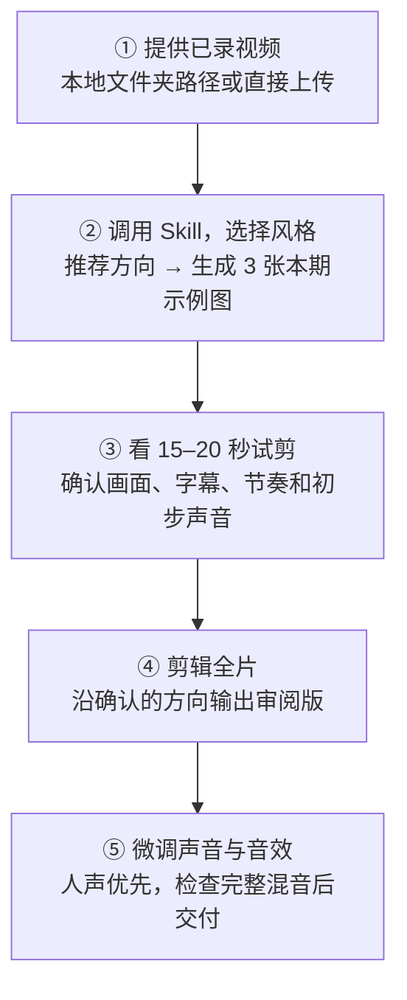

# Story-First Video Editor

A Codex skill for turning talking-head footage into a clear, evidence-aware, reviewable creator video. It covers the editorial map, captions, explanatory visuals, separate audio tracks, local revisions, and honest final checks. It works with your chosen editor or FFmpeg workflow; the skill does not bundle footage, music, fonts, or a rendering engine.

## Install

```bash
git clone https://github.com/hermanzzy-crypto/story-first-video-editor.git ~/.codex/skills/story-first-video-editor
```

Restart Codex to refresh skill discovery, then invoke `$story-first-video-editor` or describe a story-led talking-head edit. The `SKILL.md` is the entrypoint. The references are read only when needed.

## 开工前需要安装什么

| 使用方式 | 需要提前安装的 Skill | 其他运行工具 |
| --- | --- | --- |
| 只做策划、复盘、剪辑方案，或使用已有图形剪辑软件 | 本仓库的 `story-first-video-editor` | 实际剪辑时使用你已有的软件 |
| 让 Codex 在本机执行剪切、字幕、混音和导出 | 本 Skill ＋ [`ffmpeg-skill`](https://github.com/kajisho5/ffmpeg-skill#install) | Node.js（提供 `npx`）、Python 3.9+、FFmpeg 5+ 和 `ffprobe` |
| 还要用代码制作 MG 动画或 Remotion 视频 | 上一行 ＋ [Remotion Agent Skills](https://www.remotion.dev/docs/ai/skills) | Remotion 项目及其 Node.js 依赖 |

本地自动剪辑路线，在安装上方的本 Skill 后执行：

```bash
npx ffmpeg-skill --codex
npx ffmpeg-skill doctor
```

需要 Remotion 动效时再执行；在安装向导中选择 Codex 和安装范围：

```bash
npx skills add remotion-dev/skills
```

安装完 Skill 后重启 Codex。[详细安装说明](references/tooling-install.md)包含来源、环境检查和可选工具。`mg-styles-15` 上游是风格参考库，并非必须预装的官方 Codex Skill；本仓库已自带下方 15 种风格的原创指令。转写 Skill 也不是前置条件：可用现有字幕或其他转写工具。

## 如何使用：从已录视频到成片



1. **给素材**：把已录好的视频放在本地文件夹，并告诉 Codex 绝对路径；也可以直接上传视频。附上平台、画幅和已有字幕或参考素材更方便开工。
2. **选风格、看 3 张图**：调用 `$story-first-video-editor`。Skill 会根据口播推荐一种主风格和至多一种备选，请你选择；然后用**这条视频的真实内容**做开场、解释画面、案例画面 3 张示例图（没有案例时改用结尾或转折画面）。如果你已指定风格，直接按指定方向做图。
3. **先看短试剪**：制作默认约 15 秒、按内容可延长至 20 秒的综合试剪，包含人声、字幕和关键画面；准备使用配乐或音效时一并放入，方便你判断节奏、清晰度与听感。
4. **再剪全片**：根据你对示例图和试剪的反馈，扩展到完整视频，输出可播放的审阅版并保留上一版。
5. **最后调声音**：优先保证人声清楚，再微调配乐；按需要加入克制的音效，试听完整混音并做成片检查。**如需完整音效库，请联系 Herman 获取；本仓库不附带音效素材。**

可以直接复制这段话开始：

```text
$story-first-video-editor 请剪辑我上传的视频（或读取 /绝对路径/素材文件夹）。
发布平台和画幅：____。请先推荐风格，并用本期内容做 3 张示例图；
我确认方向后，做约 15 秒综合试剪，再扩展到全片并微调声音。
```

已有审阅版、只需改一处字幕或音量时，直接说明修改位置；Skill 会沿用已选风格，检查受影响片段与接点。

## 15 种视频风格速览


这是一张可放大的静态菜单；下表方便搜索和复制名称。[查看每种风格的具体制作指令](references/visual-styles.md)。

| 风格 | 大致效果与适合内容 |
| --- | --- |
| 1. 扁平矢量 Flat Vector | 简洁色块和图形逐步建立关系，适合逻辑、对比和框架。 |
| 2. 线条动画 Line Art | 用线的延伸和分叉带观众走一遍推理，适合路径、流程和决策。 |
| 3. 等距 2.5D Isometric | 像俯看微缩系统一样展示模块与流向，适合产品架构和工作流。 |
| 4. 柔和 3D Soft 3D | 以柔光、材质和缓慢镜头突出一个主体，适合产品或概念开场。 |
| 5. 手绘逐帧 Frame-by-Frame | 保留笔触和轻微抖动，强调人物动作、情绪与故事感。 |
| 6. 编辑式拼贴 Collage | 将真实照片、文档与纸张层叠，适合历史背景、媒体报道和有来源的案例。 |
| 7. 液态动画 Liquid Motion | 让颜色和形状柔和流动，适合有意义的章节过渡。 |
| 8. 形状变换 Shape Morph | 让旧状态逐步变成新状态，适合变化过程与前后对比。 |
| 9. 包豪斯几何 Bauhaus | 用圆、条、网格组织信息和节奏，适合清晰的结构与章节开场。 |
| 10. Synthwave / VHS | 霓虹、扫描纹理与复古透视，适合确实涉及旧技术或怀旧文化的内容。 |
| 11. 极光玻璃 Aurora Glass | 柔和光晕与半透明面板，适合轻未来感、抽象概念的解释。 |
| 12. 综艺花字 Variety Captions | 在口播关键字上做短促强调，适合笑点、反转与轻松节奏。 |
| 13. 贴纸科普 Sticker Explainer | 围绕真实截图或物件加少量标注，适合案例拆解与证据讲解。 |
| 14. 像素动画 Pixel Art | 统一像素网格与逐格运动，适合游戏、开发者文化和相关机制。 |
| 15. 科技 HUD / FUI | 以界面、数据和聚焦动效引导视线，适合有可靠数据来源的监控场景。 |

新视频先根据口播和素材推荐一种主风格、至多一种备选，再用本期真实内容做样张和 15–20 秒试剪；已有风格的局部修改可直接沿用。

## Use it for

- Editing an interview or spoken essay into a short creator video with meaningful on-screen explanation.
- Revising an existing cut while keeping captions, animation, music, and sound cues aligned.
- Reviewing whether a technically valid video is also visually clear and audible.

For a simple format conversion or a single trim, use a basic editing tool directly.

## Cue timing check

The optional Python 3 script checks a JSON cue sheet for invalid timing, out-of-bounds cues, overlaps, and dense stretches:

```bash
python3 scripts/audit_cues.py cues.json --duration 180
```

A cue can use `start` or `at`, plus `duration` or `end`; times can be seconds or `mm:ss`. Density warnings are prompts to listen, not proof of a poor mix.

## Scope and status

The skill generalizes lessons from multi-version spoken-video edits. It does not include those projects or imply that their final cuts passed continuous listening or user acceptance. Adapt speed, aspect ratio, platform, style, approval points, and audio levels to the actual request.

MIT licensed. Contributions that improve clarity, cue auditing, and review evidence are welcome.
